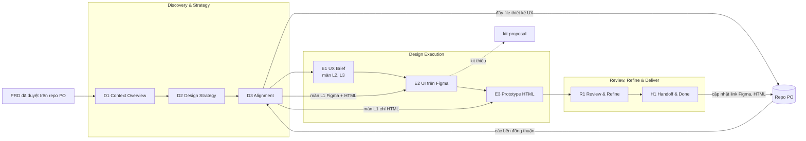
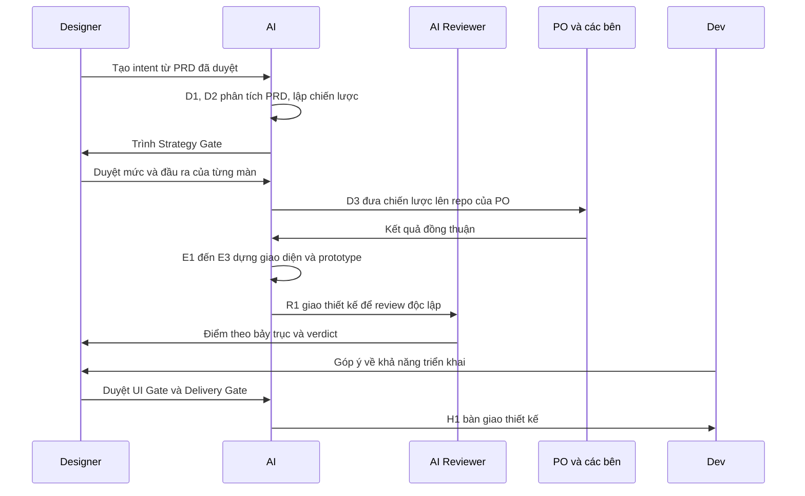
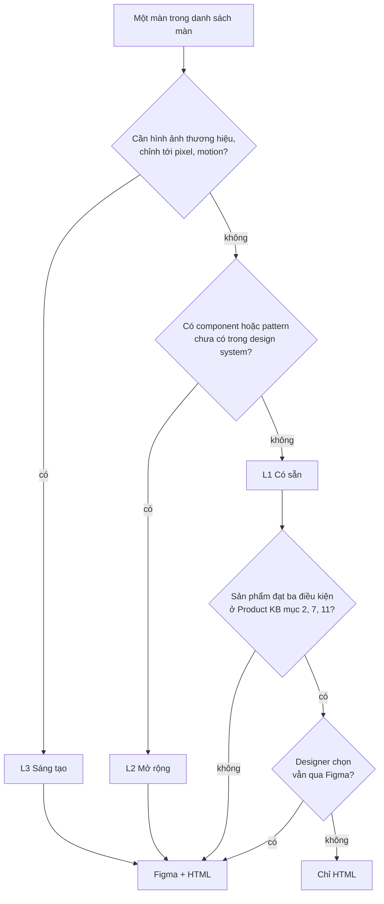
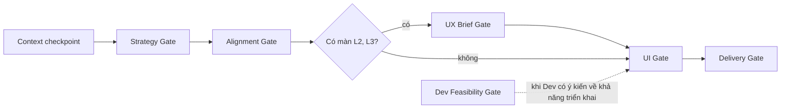
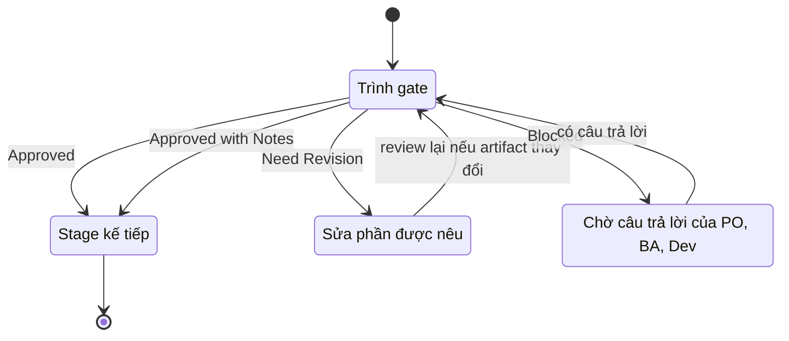
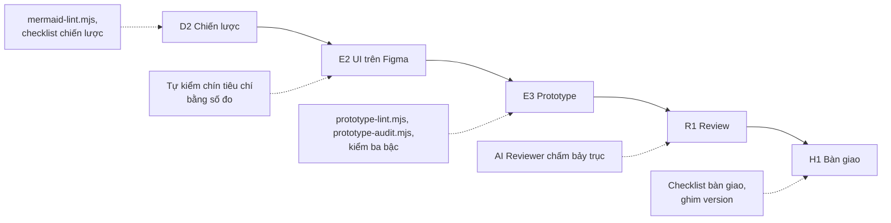
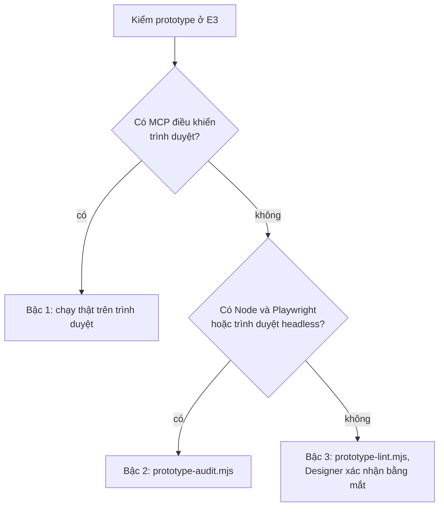
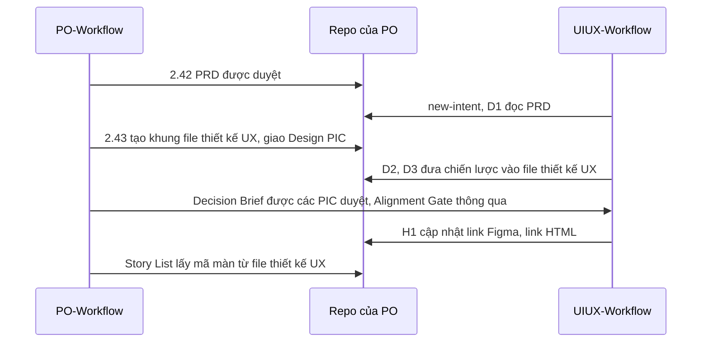
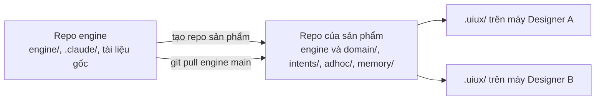
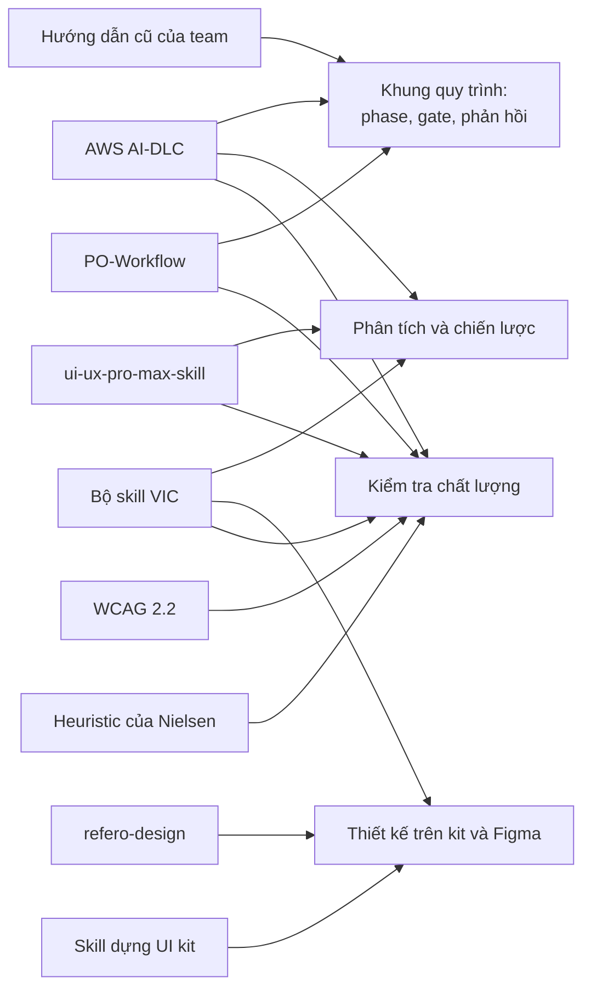

# UIUX-Workflow

UIUX-Workflow là quy trình thiết kế giao diện và trải nghiệm người dùng, trong đó UI/UX Designer làm việc cùng AI. Quy trình bắt đầu khi PRD của PO được duyệt và kết thúc khi thiết kế được bàn giao cho Dev.

Trong quy trình, Designer và AI cùng đọc hiểu PRD, xây dựng chiến lược thiết kế và đưa chiến lược lên repo của PO để các bên đồng thuận. Giao diện chỉ được dựng sau bước đồng thuận, bằng UI kit của sản phẩm, kèm prototype HTML thao tác được. AI đảm nhận việc đọc tài liệu, phân tích, dựng giao diện, đo kiểm và soạn tài liệu. Designer ra quyết định và phê duyệt ở cuối mỗi stage.

Mọi quyết định, câu trả lời và bản đã duyệt được lưu trong repo git của sản phẩm. Phần quy trình dùng chung (engine) được tách khỏi knowledge base của từng sản phẩm (Product KB), vì vậy một bản engine áp dụng được cho nhiều sản phẩm.

| Tài liệu | Người đọc | Nội dung |
|---|---|---|
| README.md | Mọi người | Giới thiệu quy trình: phạm vi, nguyên lý, stage, mức thiết kế, kiểm tra chất lượng, cơ sở phương pháp |
| [USER-GUIDE.md](USER-GUIDE.md) | Designer | Phần A: cài đặt, cách kết nối Figma, repo của PO. Phần B: các bước thực hiện một việc từ PRD tới bàn giao |
| [DOMAIN-SETUP.md](DOMAIN-SETUP.md) | Người phụ trách quy trình | Mười một mục của Product KB, cách đưa một sản phẩm vào quy trình |
| [GLOSSARY.md](GLOSSARY.md) | Mọi người | Thuật ngữ và họ mã |
| [AGENTS.md](AGENTS.md) | Công cụ AI | Quy tắc AI phải tuân thủ; `CLAUDE.md` chỉ nạp lại file này |
| [CHANGELOG.md](CHANGELOG.md) | Người phụ trách quy trình | Thay đổi của từng phiên bản, cách nâng cấp, các việc còn mở |

## Mục lục

1. [Tổng quan](#1-tổng-quan)
2. [Nguyên lý nền](#2-nguyên-lý-nền)
3. [Quy trình](#3-quy-trình)
4. [Từng stage](#4-từng-stage)
5. [Kiểm tra chất lượng](#5-kiểm-tra-chất-lượng)
6. [Kết nối với PO-Workflow và AI-DLC](#6-kết-nối-với-po-workflow-và-ai-dlc)
7. [Cài đặt, cấu trúc repo và nâng cấp](#7-cài-đặt-cấu-trúc-repo-và-nâng-cấp)
8. [Cơ sở phương pháp](#8-cơ-sở-phương-pháp)

## 1. Tổng quan

### 1.1 Phạm vi

Mỗi yêu cầu thiết kế là một intent, lưu tại `intents/<slug>/`. Intent đi qua tám stage thuộc ba phase. Discovery & Strategy hiểu yêu cầu và thống nhất chiến lược thiết kế. Design Execution dựng giao diện và prototype. Review, Refine & Deliver rà soát, xử lý góp ý và bàn giao. Độ sâu của từng bước được quyết định riêng cho từng màn, dựa trên mức thiết kế của màn đó.

| Áp dụng cho | Ngoài phạm vi |
|---|---|
| Tính năng mới hoặc thay đổi có giao diện, sau khi PRD được duyệt | Phân tích nghiệp vụ, viết PRD: việc của PO |
| Các bước từ đọc PRD tới bàn giao thiết kế cho Dev | Dựng UI kit, design system: việc của người phụ trách kit |
| Thiết kế bằng UI kit có sẵn trên Figma, prototype HTML, thiết kế bằng HTML cho màn đơn giản | Thiết kế API, dữ liệu, chọn thư viện code: việc của Dev |
| Thay đổi sau khi chiến lược đã đồng thuận; góp ý của Dev sau bàn giao | Viết test case: việc của QA |
| Rà soát màn đang vận hành, không cần tạo intent | Quản lý tiến độ thay cho công cụ quản lý task |

Điều kiện bắt đầu gồm hai điểm: PRD đã được duyệt, và sản phẩm có Product KB ở mức Tối thiểu theo [DOMAIN-SETUP.md](DOMAIN-SETUP.md). Khi Product KB chưa đủ, lệnh tạo intent hỏi bổ sung sáu thông tin tối thiểu ở lần chạy đầu tiên.

### 1.2 Vòng đời của một intent

Mỗi stage có một mã gồm chữ cái của nhóm việc và số thứ tự: D cho Discovery & Strategy, E cho Design Execution, R cho Review & Refine, H cho Handoff. Các phần sau của tài liệu dùng mã này.

| Mã | Stage | Phase | Việc chính |
|---|---|---|---|
| D1 | Context Overview | Discovery & Strategy | Đọc hiểu PRD và bối cảnh, lập câu hỏi cho PO |
| D2 | Design Strategy | Discovery & Strategy | Flow, danh sách màn, state, trường hợp biên, mức thiết kế và đầu ra của từng màn |
| D3 | Alignment | Discovery & Strategy | Đưa chiến lược lên repo của PO, chờ các bên đồng thuận |
| E1 | UX Brief | Design Execution | Brief bố cục và nội dung cho màn L2, L3 |
| E2 | UI Design | Design Execution | Giao diện trên Figma bằng UI kit |
| E3 | Prototype | Design Execution | Prototype HTML thao tác được; thiết kế chính của màn chỉ HTML |
| R1 | Review & Refine | Review, Refine & Deliver | Review độc lập, gom góp ý, sửa thiết kế |
| H1 | Handoff & Done | Review, Refine & Deliver | Bàn giao cho Dev, cập nhật link trên repo của PO |



Sơ đồ trên: intent đi qua ba phase. Sau Alignment, màn L2 và L3 qua UX Brief; màn L1 đi Figma + HTML bắt đầu từ E2; màn L1 chỉ HTML đi thẳng tới E3. Mọi màn hội tụ ở R1 và H1, và H1 cập nhật link bàn giao vào repo của PO. Mức L1, L2, L3 và cách chọn đầu ra của màn được giải thích ở mục 3.2.

### 1.3 Vai trò

| Vai | Trách nhiệm |
|---|---|
| AI | Đọc PRD và Product KB trước khi đặt câu hỏi; phân tích flow, màn, state, trường hợp biên; đề xuất mức thiết kế; dựng giao diện bằng instance của UI kit hoặc bằng HTML; dựng prototype; đo và tự kiểm; soạn file thiết kế UX và ghi chú bàn giao; ghi phần chưa rõ thành câu hỏi cho PO hoặc Designer (ký hiệu `❓PO`, `❓Designer`) thay vì suy đoán |
| Designer | Phê duyệt hoặc yêu cầu sửa ở mỗi gate; quyết định mức thiết kế, đầu ra của màn, hướng thị giác và phương án; tự dựng giao diện cho màn cần sáng tạo hoặc khi muốn; xử lý góp ý |
| AI Reviewer | Agent review độc lập, chỉ đọc thiết kế và tài liệu được giao, không tiếp cận hội thoại giữa Designer và AI; chấm điểm theo bảy trục và kết luận verdict |
| PO | Cung cấp PRD đã duyệt; trả lời câu hỏi; cùng các bên đồng thuận chiến lược thiết kế ở D3. PO không duyệt chi tiết thiết kế; bản cuối được xem trên Figma và prototype |
| BA, Dev, QA | Trả lời câu hỏi; góp ý ở R1; Dev nêu ý kiến về khả năng triển khai; nhận bàn giao |
| Người phụ trách kit | Nhận đề xuất bổ sung component, quyết định việc dựng vào UI kit |
| Người phụ trách quy trình | Duy trì engine và Product KB, tổng hợp bài học |

Trình tự tương tác giữa các vai trong một intent điển hình:



Sơ đồ trên: Designer khởi tạo intent và phê duyệt ở các gate; AI thực hiện phần phân tích, dựng và soạn tài liệu; PO và các bên chỉ tham gia ở bước đồng thuận chiến lược; AI Reviewer review độc lập trước khi Designer duyệt; Dev góp ý ở R1 và nhận bàn giao ở H1.

### 1.4 Đầu ra bàn giao

| Đầu ra | Người nhận | Thời điểm |
|---|---|---|
| Chiến lược thiết kế, đưa vào file thiết kế UX trên repo của PO | PO, Dev, QA | D3; cập nhật link ở H1 |
| Thiết kế trên Figma, ghim version bàn giao | Dev, QA | H1, cho màn đi Figma + HTML |
| File HTML: prototype của mọi màn, đồng thời là thiết kế chính của màn chỉ HTML, ghim theo commit | PO, Dev, QA | E3; ghim ở H1 |
| `delivery-summary.md`: mục lục bàn giao và checklist cho Dev | Dev | H1 |
| Đề xuất bổ sung UI kit, ghi trong gap log | Người phụ trách kit | Khi gặp phần tử kit chưa có |

### 1.5 Đặc điểm chính

| Đặc điểm | Cơ chế |
|---|---|
| Thống nhất chiến lược trước khi thiết kế | D3 đưa chiến lược lên repo của PO; giao diện chỉ được dựng sau khi Alignment Gate được thông qua |
| Độ sâu theo từng màn | Mức L1, L2, L3 kết hợp với độ phức tạp logic quyết định UX Brief, review và đầu ra của màn |
| Đầu ra gọn cho màn đơn giản | Màn chỉ ghép component có sẵn được thiết kế và bàn giao bằng HTML, không qua Figma, khi sản phẩm đủ điều kiện |
| Bám đúng UI kit của sản phẩm | Giao diện dựng bằng instance của kit; phần tử kit chưa có được ghi `GAP` và đề xuất qua `/kit-proposal`, AI không tự dựng thay |
| An toàn với file Figma | AI chỉ ghi vào khu vực nháp và lưu version có tên trước mỗi lần ghi |
| Quyết định được lưu vết | Lời duyệt và câu trả lời ghi nguyên văn trong `decisions.md`; bản đã duyệt được chụp vào `archive/` |
| Chất lượng đo được | Checklist có mục chặn, review độc lập, script kiểm sơ đồ và prototype; stage chỉ được báo hoàn thành sau khi đã đo |
| Dùng chung cho nhiều sản phẩm và công cụ | Engine tách khỏi Product KB; bốn cách kết nối Figma; chạy được với công cụ AI khác qua `AGENTS.md`; cài đặt từ link repo bằng `/setup` |

### 1.6 Khác biệt so với thiết kế trực tiếp bằng AI hội thoại

| Khía cạnh | Dùng trực tiếp AI hội thoại | UIUX-Workflow |
|---|---|---|
| Hiểu yêu cầu | AI suy luận từ đoạn mô tả được dán vào | AI đọc PRD và Product KB, tách Confirmed, Assumption, Open question; điểm chưa rõ trở thành câu hỏi cho PO |
| Thông tin còn thiếu | AI tự bổ sung | AI ghi thành câu hỏi cho người nắm thông tin: PO với nội dung yêu cầu, Designer với lựa chọn thiết kế. Câu hỏi chặn bước tiếp theo thì AI dừng lại chờ trả lời |
| Bám design system | AI tự chọn màu, chữ, component | Chỉ dùng component và token của UI kit; phần thiếu ghi `GAP` |
| State và trường hợp biên | Phụ thuộc vào việc người hỏi có nhớ hay không | Bảy state cho mỗi màn, rà trường hợp biên theo danh mục, độ sâu theo mức của màn |
| Kiểm soát chất lượng | Designer tự rà bằng mắt | Checklist, review độc lập theo thang điểm, script kiểm, chuẩn WCAG 2.2 mức AA |
| Lưu vết và bàn giao | Phân tán trong lịch sử hội thoại | Quyết định ghi nguyên văn; link bàn giao ghim version Figma hoặc commit HTML |

## 2. Nguyên lý nền

| Nguyên lý | Áp dụng trong quy trình |
|---|---|
| AI thực hiện, Designer kiểm soát | Gate ở cuối mỗi stage; AI không quyết định thay Designer, chỉ đề xuất dưới nhãn Recommendation |
| Hiểu trước, đồng thuận trước, thiết kế sau | D1, D2 diễn ra trước khi dựng; D3 chờ các bên đồng thuận; giao diện chỉ được dựng sau Alignment Gate |
| Không phân tích lại nghiệp vụ | PRD là đầu vào; khác biệt được ghi thành Ý kiến về PRD kèm lập trường và lý do; AI không sửa PRD |
| Các bên ngoài tham gia ở cấp chiến lược | Các bên đồng thuận ở D3; chi tiết thiết kế do Designer quyết định |
| Độ sâu tương ứng với độ khó của từng màn | Mức thiết kế L1, L2, L3 và độ phức tạp logic; đầu ra theo mức |
| Tận dụng những gì đã có | Component của UI kit, pattern của các màn liền kề; phần thiếu chỉ được đề xuất bổ sung vào kit |
| Bảo toàn thiết kế chính | Khu vực nháp trên Figma, lưu version trước khi ghi |
| Kết quả phải đo được | Số đo, ảnh chụp, checklist; điều chưa kiểm được ghi vào mục Limitation |

## 3. Quy trình

### 3.1 Các stage

| Phase | Stage | Mục đích | Đầu ra | Gate |
|---|---|---|---|---|
| Discovery & Strategy | D1 Context Overview | Đọc hiểu PRD và bối cảnh; user task; câu hỏi cho PO | `context-overview.md` | Context checkpoint |
| | D2 Design Strategy | Flow, màn, bảy state, trường hợp biên, mức và đầu ra của từng màn, ánh xạ UI kit, accessibility, ý kiến về PRD; flow prototype khi cần | `design-strategy.md`, `flow-map.md` | Strategy Gate |
| | D3 Alignment | Đưa chiến lược lên repo của PO theo template của PO; chờ các bên đồng thuận | File thiết kế UX trên repo PO | Alignment Gate |
| Design Execution | E1 UX Brief | Màn L2: đề xuất component; màn L3: design ref, chọn hướng thị giác; bố cục, nội dung chữ. Màn L1 được nén vào D2 | `ux-brief.md` | UX Brief Gate |
| | E2 UI Design | Giao diện trên Figma bằng instance của UI kit, trong khu vực nháp; tự kiểm. Chỉ áp dụng cho màn Figma + HTML | Frame Figma, `build-report.md` | Không có gate, chuyển sang E3 |
| | E3 Prototype | HTML thao tác được trọn luồng, đổi state, đổi vai. Với màn chỉ HTML, file HTML là thiết kế chính và có chế độ ghi chú bàn giao | `index.html`, `prototype-report.md` | Không có gate, chuyển sang R1 |
| Review, Refine & Deliver | R1 Review & Refine | Review độc lập; góp ý của BA, Dev; xử lý khả năng triển khai với Dev; sửa thiết kế | `feedback.md`, `design-review.md` | UI Gate |
| | H1 Handoff & Done | Ghi chú bàn giao; ghim version; cập nhật file thiết kế UX trên repo PO | `delivery-summary.md` | Delivery Gate |

### 3.2 Mức thiết kế và đầu ra của màn

Mỗi màn được gán một mức thiết kế ở D2 và được Designer duyệt ở Strategy Gate. Mức thiết kế quyết định nội dung UX Brief, người dựng giao diện và việc màn có cần Figma hay không.



Sơ đồ trên: màn cần yếu tố thị giác riêng là L3, màn cần component hoặc pattern mới là L2, các màn còn lại là L1. Màn L2 và L3 luôn đi Figma + HTML. Màn L1 đi chỉ HTML khi sản phẩm đạt ba điều kiện và Designer không chọn giữ Figma cho màn đó.

| Mức | Đặc điểm của màn | Đầu ra | Yêu cầu bổ sung |
|---|---|---|---|
| L1 Có sẵn | Ghép từ component đã có: form, bảng, CRUD, màn quản trị, vận hành nội bộ; thay đổi ở luồng, trạng thái, field, câu chữ | Chỉ HTML khi sản phẩm đạt ba điều kiện dưới đây; trường hợp còn lại là Figma + HTML | UX Brief nén vào chiến lược; AI dựng giao diện |
| L2 Mở rộng | Có component hoặc pattern chưa có trong design system | Figma + HTML | UX Brief có wireframe và đề xuất component; `/kit-proposal` |
| L3 Sáng tạo | Hình ảnh, thương hiệu, màn cho khách hàng cần chỉnh tới từng pixel, motion, landing | Figma + HTML | Design ref bắt buộc; chọn một trong hai đến ba hướng thị giác; Designer dẫn phần giao diện |

Ba điều kiện để màn L1 đi làn chỉ HTML được khai một lần trong Product KB:

| Điều kiện | Mục Product KB |
|---|---|
| Dev nhận bàn giao bằng HTML, không cần Dev Mode hoặc Code Connect của Figma | Mục 11 |
| Có thư viện component frontend tải được trong một file HTML, kèm bảng ánh xạ component kit sang code | Mục 7 |
| Người duyệt chấp nhận xem thiết kế trên trình duyệt | Mục 2 |

Khi một màn đã có trên Figma được sửa bằng HTML, H1 cập nhật lại màn đó trên Figma để file Figma luôn khớp với bản bàn giao. Trục thứ hai là độ phức tạp logic, gồm hai mức thường và phức tạp. Trục này quyết định độ sâu khi rà trường hợp biên, mức chi tiết của đặc tả hành vi, và việc review độc lập có bắt buộc hay không. Chi tiết ở `engine/protocol/design-levels.md`.

### 3.3 Đường đi của một intent qua các gate



Sơ đồ trên: mọi intent qua Strategy, Alignment, UI và Delivery Gate. UX Brief Gate chỉ xuất hiện khi có màn L2 hoặc L3. Dev Feasibility Gate chỉ mở trong R1 khi Dev có ý kiến về khả năng triển khai.

| Tình huống | Số gate |
|---|---|
| Thay đổi trên màn có sẵn, mọi màn L1, logic thường | 4: D1 chạy liền D2 nên Context checkpoint gộp vào Strategy Gate; làn chỉ HTML không có E2 |
| Mọi màn L1, có flow mới hoặc màn logic phức tạp | 5 |
| Có ít nhất một màn L2 hoặc L3 | 6, thêm UX Brief Gate |

Alignment Gate phụ thuộc vào các bên ngoài nhóm thiết kế nên thường chiếm nhiều thời gian nhất; trong thời gian chờ, Designer có thể xử lý việc khác.

### 3.4 Gate và phản hồi

Mỗi gate trình bày bảng kết quả bằng số, đường dẫn để mở artifact, và bốn lựa chọn phản hồi theo hướng dẫn trước đây của team.



Sơ đồ trên: Approved và Approved with Notes chuyển intent sang stage kế tiếp; Need Revision quay lại bước sửa rồi trình lại; Blocked tạm dừng cho tới khi có câu trả lời.

| Phản hồi | Hệ quả |
|---|---|
| Approved | Ghi quyết định nguyên văn, chụp bản duyệt vào `archive/`, chuyển sang stage kế tiếp; AI đề xuất commit |
| Approved with Notes | Như Approved; ghi chú được đưa vào bước đầu của stage sau |
| Need Revision | Sửa đúng phần được nêu, chạy lại review nếu artifact thay đổi, trình lại |
| Blocked | Tạm dừng, soạn sẵn câu hỏi cho PO, BA, Dev; tiếp tục khi có câu trả lời |

Từ lần Need Revision thứ ba, AI đề xuất Approved with Notes kèm điều kiện cụ thể để vòng sửa không kéo dài vô hạn; quyết định cuối cùng vẫn thuộc về Designer.

## 4. Từng stage

- D1 Context Overview: AI đọc PRD và tài liệu của PO, tóm tắt tính năng, các vai, việc người dùng thực hiện trên giao diện, phần wireframe PO đã quyết định, ước tính số màn và mức của từng màn, câu hỏi cho PO kèm tin nhắn soạn sẵn.
- D2 Design Strategy: AI lập sơ đồ flow bằng Mermaid đã kiểm cú pháp, danh sách màn gắn với user story, bảy state cho mỗi màn, trường hợp biên theo mức Must, Should, Optional, mức và đầu ra của từng màn, ánh xạ vùng màn hình sang component của kit, các điểm lưu ý về accessibility và ý kiến về PRD. Với flow mới có độ phức tạp cao, AI dựng thêm flow prototype khung xám để các bên thao tác thử trước buổi đồng thuận.
- D3 Alignment: AI đưa các mục chiến lược mà các bên cần đọc vào file thiết kế UX trên repo của PO, theo template của PO. Khi repo chỉ cho phép đọc hoặc không có repo, AI xuất file để Designer gửi. AI đọc kết quả đồng thuận và sửa chiến lược khi có quyết định thay đổi.
- E1 UX Brief: màn L2 có đề xuất component mới dựa trên style hiện có để Designer chọn; màn L3 có phân tích design ref, hai đến ba hướng thị giác và reference lock. Mọi màn có thứ bậc thông tin, wireframe dạng khối, nội dung chữ thật, tương tác và state.
- E2 UI Design: với màn Figma + HTML, AI lưu version, dựng trong khu vực nháp bằng instance của kit, chia đợt đối với intent nhiều màn và tự kiểm chín tiêu chí bằng số đo. Màn L3 do Designer dẫn.
- E3 Prototype: một file HTML mở được bằng trình duyệt, có bảng điều khiển đổi vai, đổi bộ dữ liệu và ép state. Màn Figma + HTML lấy cấu trúc từ frame Figma; màn chỉ HTML được dựng trực tiếp bằng component của frontend theo bảng ánh xạ và có chế độ ghi chú bàn giao. Prototype được kiểm theo ba bậc, mô tả ở mục 5.
- R1 Review & Refine: ở vòng 1, agent AI Reviewer review độc lập và chấm điểm; ở vòng 2, góp ý của BA, Dev và Reviewer được gom vào feedback matrix. Ý kiến của Dev về khả năng triển khai mở Dev Feasibility Gate với hai đến ba phương án kèm trade-off.
- H1 Handoff & Done: AI ghi chú bàn giao trên Figma hoặc trong file HTML; lưu version Figma và commit file HTML để ghim link; cập nhật file thiết kế UX trên repo PO; soạn `delivery-summary.md` và nội dung chuyển task sang Done. Intent kết thúc bằng một lượt hỏi về bài học cần lưu.

Designer có thể diễn đạt yêu cầu bằng ngôn ngữ tự nhiên; AI định tuyến yêu cầu sang lệnh tương ứng theo bảng trong `AGENTS.md`.

| Lệnh | Chức năng |
|---|---|
| `/setup` | Cài đặt trên máy mới, kiểm tra lại hoặc đổi cách kết nối Figma |
| `/new-intent` | Tạo việc từ PRD đã duyệt, hỏi bổ sung Product KB tối thiểu, chạy D1 |
| `/ux` | Thực hiện bước kế tiếp hoặc tiếp tục phần chưa hoàn tất |
| `/ux-status` | Trạng thái các việc, kiểm tra độ lệch với repo PO và Figma |
| `/ux-review` | Review độc lập chiến lược, hoặc `--shadow` cho màn đang vận hành |
| `/change-request` | Thay đổi chiến lược đã đồng thuận |
| `/kit-proposal` | Đề xuất bổ sung component vào UI kit; chỉ đề xuất, không dựng |
| `/ds-lookup` | Tra luật design system và cách dùng kit |
| `/new-domain` | Dựng Product KB cho một sản phẩm |

## 5. Kiểm tra chất lượng

Mỗi stage có lớp kiểm riêng, gắn vào đúng thời điểm artifact được tạo ra:



Sơ đồ trên: D2 kiểm cú pháp sơ đồ và checklist chiến lược; E2 tự kiểm giao diện bằng số đo; E3 kiểm prototype bằng hai script; R1 có review độc lập; H1 kiểm checklist bàn giao và ghim version. Chuẩn WCAG 2.2 mức AA áp dụng xuyên suốt các bước.

| Lớp kiểm | Cơ chế |
|---|---|
| Checklist từng stage | Mục `[BLOCK]` chặn gate cho tới khi đạt |
| Tự kiểm giao diện | Chín tiêu chí trên Figma ở E2: độ phủ, biến, instance, chữ, icon, mode và breakpoint, accessibility, bố cục, nhất quán. Màn chỉ HTML có bộ tự kiểm riêng ở E3 |
| Review độc lập | Agent AI Reviewer không thấy hội thoại thiết kế; chấm bảy trục: Requirement fit, Flow và IA, Heuristic, Visual hierarchy, Consistency, Accessibility, Responsive và nội dung. Bắt buộc với màn L2, L3 và màn logic phức tạp |
| Script | `mermaid-lint.mjs` kiểm cú pháp sơ đồ ở D2; `prototype-lint.mjs` kiểm tĩnh file prototype (khung file, thư viện ghim version, dữ liệu mẫu ổn định, cú pháp JavaScript); `prototype-audit.mjs` kiểm prototype theo từng màn ở nhiều cỡ màn hình |
| Accessibility | WCAG 2.2 mức AA: tương phản, vùng chạm, focus, tên trợ năng, không truyền thông tin chỉ bằng màu; ngưỡng riêng của sản phẩm khai ở Product KB mục 9 |
| An toàn file thiết kế | Đọc trước, ghi sau; chỉ ghi vào khu vực nháp; lưu version trước khi ghi |
| Báo cáo đúng mức đã kiểm | Stage chưa đo hoặc chưa chụp thì chưa được báo hoàn thành; prototype chưa chạy được trên trình duyệt thì không ghi "đã chạy thử"; phần chưa kiểm ghi vào Limitation |

Mức kiểm prototype phụ thuộc vào công cụ có trên máy của Designer:



Sơ đồ trên: AI dùng bậc kiểm cao nhất mà máy cho phép; `prototype-lint.mjs` chạy ở mọi bậc vì chỉ cần Node. Ở bậc 3, báo cáo ghi rõ prototype chưa được chạy thử và phần việc Designer cần tự xác nhận.

Kiến thức chuyên môn dùng khi thiết kế và khi kiểm nằm ở `engine/knowledge/`: đọc yêu cầu, phân tích flow, rà trường hợp biên, bảy state, UX writing tiếng Việt, design ref, trực quan hoá dữ liệu, prototype, heuristic, accessibility và thang chấm review.

## 6. Kết nối với PO-Workflow và AI-DLC

### 6.1 PO-Workflow



Sơ đồ trên: hai quy trình trao đổi qua repo của PO. UIUX-Workflow đọc PRD sau bước 2.42, ghi chiến lược vào file thiết kế UX do PO tạo ở bước 2.43, chờ Decision Brief được duyệt, và cập nhật link bàn giao để Story List của PO sử dụng.

| PO-Workflow | UIUX-Workflow |
|---|---|
| 2.42 PRD được duyệt | `/new-intent`, D1 đọc PRD |
| 2.43 Design Alignment: PO tạo khung file thiết kế UX và giao Design PIC | D2 viết chiến lược; D3 đưa vào file đó |
| Decision Brief, các PIC duyệt | Alignment Gate chờ kết quả này |
| Story List lấy mã màn từ file thiết kế UX | H1 cập nhật link Figma, link HTML trong file đó |
| Thay đổi yêu cầu đi qua change request trên PRD | `/change-request` của UIUX, chạy lại D3 cho phần thay đổi |

Đường dẫn, template và quy ước cụ thể nằm ở Product KB mục 2, không ghi cứng trong engine. Sơ đồ trong file thiết kế UX đã qua `mermaid-lint.mjs` thì cũng qua bước kiểm sơ đồ của PO-Workflow, vì hai bên dùng cùng bộ quy tắc.

### 6.2 Đối chiếu với AWS AI-DLC

| | AWS AI-DLC | UIUX-Workflow |
|---|---|---|
| Người thực hiện | Design Agent: wireframe, interaction design, accessibility, design system compliance | Designer cùng AI |
| Thời điểm | 1.6 Rough Mockups ở Ideation; 2.5 Refined Mockups ở Inception, sau User Stories, trước Domain Design | Sau khi PRD được duyệt: D2 chiến lược, D3 đồng thuận, sau đó E1 đến H1 |
| Đầu ra | Toàn bộ bằng Markdown: wireframes, user flow, mockups, interaction spec, design system mapping, accessibility checklist | Chiến lược bằng Markdown, giao diện trên Figma hoặc HTML, prototype HTML |
| Phê duyệt | Product Lead review mang tính tham vấn; người duyệt ở gate | Strategy Gate do Designer; Alignment Gate do các bên; review độc lập ở R1 |

Mục 1 đến 4 của `design-strategy.md` được đặt theo bốn artifact của stage 2.5 Refined Mockups, nhằm giảm khối lượng thay đổi khi chuyển sang AI-DLC.

## 7. Cài đặt, cấu trúc repo và nâng cấp

Cài đặt: Designer cài Claude Code, đăng nhập, mở Claude Code ở thư mục bất kỳ và gửi yêu cầu `Cài đặt UIUX-Workflow từ https://github.com/buidhui/uiux-workflow`. AI tải repo và hướng dẫn từng bước: kết nối Figma, nối repo của PO, kiểm tra. Các thao tác Designer phải tự thực hiện và cách cài thủ công nằm ở [USER-GUIDE.md](USER-GUIDE.md) Phần A. Đối với AI nhận yêu cầu cài đặt: tải repo về thư mục Designer chọn, đọc `engine/commands/setup.md` và thực hiện từ bước 0.

Quy trình vận hành được với bốn cách kết nối Figma (kể cả trường hợp không kết nối và gửi ảnh), với repo của PO có quyền push, chỉ đọc hoặc không có repo, và với công cụ AI khác Claude Code. Những việc AI không thực hiện được trong từng lựa chọn đều có cách thay thế, ghi ở USER-GUIDE mục A3.



Sơ đồ trên: mỗi sản phẩm có một repo riêng tạo từ repo engine và nhận bản engine mới bằng `git pull engine main`. Dữ liệu của sản phẩm chỉ nằm trong repo sản phẩm; cấu hình riêng của từng máy nằm trong `.uiux/` và không được commit.

| Thư mục | Nội dung | Thuộc về |
|---|---|---|
| `engine/` | Stage, lệnh, protocol, template (gồm khung Product KB), checklist, kiến thức chuyên môn, agent, script | Quy trình dùng chung |
| `.claude/` | Lối tắt lệnh và agent cho Claude Code, trỏ vào `engine/` | Quy trình dùng chung |
| `AGENTS.md`, `CLAUDE.md` và các tài liệu ở thư mục gốc | Quy tắc cho AI và tài liệu của quy trình | Quy trình dùng chung |
| `domain/` | Product KB của sản phẩm; repo engine chỉ có README | Sản phẩm |
| `intents/` | Hồ sơ từng việc thiết kế | Sản phẩm |
| `adhoc/` | Kết quả của các việc một lượt, review màn đang vận hành | Sản phẩm |
| `memory/` | Bài học của team | Sản phẩm |
| `.uiux/` | Trạng thái cài đặt và cách kết nối Figma của từng máy; không commit | Từng máy |

Mỗi intent có cấu trúc:

```
intents/<slug>/
├── intent.md          PRD và intent của PO, file Figma, prototype, design ref
├── state.md           màn, mức, đầu ra, stage, frame, version đã đẩy
├── decisions.md       quyết định nguyên văn, câu trả lời, rủi ro chấp nhận, change request
├── memory.md          quan sát của AI, xét khi đóng intent
├── inputs/            tài liệu, wireframe của PO, ảnh màn cũ; inputs/refs/ cho design ref
├── discovery/         D1, D2, D3
├── execution/         E1, E2, E3 (prototype ở execution/prototype/)
├── delivery/          R1, H1
└── archive/           bản chụp lúc duyệt, không chỉnh sửa
```

Bản engine mới chỉ thay đổi phần dùng chung; phần của sản phẩm được giữ nguyên. Việc cần làm thêm khi nâng cấp được ghi ở mục Nâng cấp của từng phiên bản trong [CHANGELOG.md](CHANGELOG.md). Product KB gồm mười một mục và ưu tiên trỏ tới nguồn có sẵn (repo PO, dữ liệu UI kit, Figma) thay vì sao chép; định nghĩa ở [DOMAIN-SETUP.md](DOMAIN-SETUP.md). Thông tin về UI kit nằm ở mục 5 của Product KB.

## 8. Cơ sở phương pháp



Sơ đồ trên: khung quy trình đến từ hướng dẫn cũ của team, AWS AI-DLC và PO-Workflow; phần phân tích và chiến lược dựa trên AWS AI-DLC, bộ skill VIC và ui-ux-pro-max-skill; phần thiết kế trên kit dựa trên bộ skill VIC, refero-design và các skill dựng UI kit; phần kiểm tra chất lượng dựa trên WCAG 2.2, heuristic của Nielsen, bộ skill VIC, ui-ux-pro-max-skill, chuẩn file HTML của AWS AI-DLC và quy tắc kiểm sơ đồ của PO-Workflow.

| Nguồn | Phần áp dụng trong quy trình |
|---|---|
| Hướng dẫn UI/UX Workflow cùng AI trước đây của team | Ba phase, các bước từ đọc yêu cầu tới bàn giao, gate, bốn cách phản hồi, bảy state cấp màn, feedback matrix, Dev Feasibility, prompt mẫu và lỗi thường gặp |
| [AWS AI-DLC Workflows](https://github.com/awslabs/aidlc-workflows), giấy phép MIT-0 | Vai Design Agent và stage 1.6, 2.5: bốn mục đầu của chiến lược thiết kế; kiến thức về interaction pattern, UX, accessibility (đã sửa theo WCAG 2.2); cấu trúc stage và gate, qua PO-Workflow; chuẩn file HTML tự đủ, meta định danh và kiểm cấu trúc tĩnh cho prototype |
| PO-Workflow | Điểm nhận và đẩy file thiết kế UX (stage 2.43); tách engine khỏi knowledge base của sản phẩm; hồ sơ intent, nhật ký quyết định, archive; định dạng câu hỏi; reviewer độc lập; vòng bài học; quy tắc kiểm sơ đồ Mermaid |
| Bộ skill VIC (quy trình UI/UX và design system) | Discovery chi tiết, bản kê thay đổi, screen contract, rà trường hợp biên, flow map, review chấm điểm bảy trục, fix-prompt, luật thao tác Figma, review màn đang vận hành, tra luật design system |
| `refero-design` | Design ref, phân tích ref, chống trung bình hoá, reference lock |
| Các bộ skill dựng UI kit trên Figma | Gap log; đề xuất bổ sung kit dừng ở bước đề xuất; không tự dựng phần kit còn thiếu |
| [ui-ux-pro-max-skill](https://github.com/nextlevelbuilder/ui-ux-pro-max-skill), giấy phép MIT | Bảng chọn biểu đồ theo dạng dữ liệu; script kiểm prototype HTML theo nhiều cỡ màn hình |
| WCAG 2.2, W3C | Chuẩn accessibility mức AA |
| Mười heuristic của Jakob Nielsen; cognitive walkthrough | Trục Heuristic của review |

Với mỗi nguồn, quy trình chỉ giữ lại phương pháp; tên biến, file key, tên sản phẩm và các số liệu không có nguồn đã được loại bỏ. Mục Nguồn ở cuối mỗi file trong `engine/knowledge/` ghi rõ phần đã lấy, đã sửa và đã bỏ. Thay đổi của từng phiên bản nằm trong [CHANGELOG.md](CHANGELOG.md).
