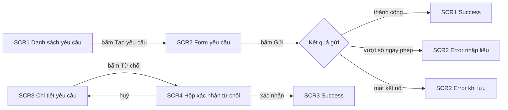

# Phân tích flow

Dùng ở D2 Design Strategy, bước 1, 2 và 4: từ user task của D1 ra flow, bước, màn, vị trí của màn trong app và mức thiết kế. Kết quả ghi vào `flow-map.md` theo `engine/templates/flow-map.md`. Không phân tích lại nghiệp vụ: điều kiện rẽ nhánh lấy từ luật nghiệp vụ (BR) trong PRD; PRD chưa có luật cần dùng thì ghi `❓PO`, không tự đặt.

## 1. Phân rã mục tiêu

| Tầng | Là gì | Lấy từ |
|---|---|---|
| Mục tiêu | Điều một vai muốn đạt | User task `UT-NN` của D1 |
| Flow | Một đường đi gồm nhiều bước để đạt mục tiêu | Mỗi user task có ít nhất một flow chính |
| Bước | Một hành động của người dùng và một phản hồi của hệ thống, trên một màn | Ghi theo dạng Vai, Hành động, Phản hồi của hệ thống, Màn |

Mỗi flow kèm điều kiện rẽ nhánh, dạng "Nếu <điều kiện> thì <FLOW hoặc bước>", có mã luật nghiệp vụ làm thẻ truy vết.

Luật dừng: bước đã là một hành động hoặc một quyết định trên một màn thì dừng phân rã. Không đi xuống từng lần bấm vào từng control; mức đó thuộc UX Brief ở E1.

Luật đào sâu: bước mà sai lầm của người dùng gây hậu quả lớn (xoá dữ liệu, gửi tới nhiều người, liên quan tới tiền, không thu hồi được) thì phân rã thêm một tầng và gắn cờ; điểm gắn cờ được đặc tả hành vi ở bước rà trường hợp biên theo `edge-case-sweep.md`.

## 2. Loại flow và cách tìm

| Loại | Là gì | Cách tìm |
|---|---|---|
| Chính | Đường thuận lợi, đạt mục tiêu không gặp trở ngại | Mỗi user task một flow chính |
| Phụ | Nhánh trong một flow, hoặc đường đi khác theo vai hoặc điều kiện | Câu hỏi bên dưới |
| Lỗi | Đường đi khi một bước thất bại | Mỗi bước gọi hệ thống hoặc ghi dữ liệu có ít nhất một nhánh lỗi |

Câu hỏi để tìm flow phụ:
- Mỗi vai trong ma trận vai và quyền của PRD có đi cùng một đường không? Vai thấy khác hoặc làm khác thì có flow riêng.
- Trạng thái của đối tượng theo sơ đồ trạng thái của PRD (chờ duyệt, đã khoá) có làm đổi đường đi không?
- Luật nghiệp vụ nào tạo rẽ nhánh (vượt hạn mức, thiếu điều kiện)?
- Người dùng vào từ các điểm khác nhau (menu, thông báo, link trực tiếp) có tới cùng bước không?
- Lần dùng đầu tiên có khác lần sau không?

Ưu tiên: P1 phải thiết kế trong intent này, P2 nên thiết kế, P3 có thì tốt. Flow hoặc màn cần có mà PRD chưa nói tới thì đánh dấu "Ngoài yêu cầu gốc" và đưa vào bảng duyệt; Designer quyết định có đề xuất mục đó không; AI không tự thêm vào phạm vi.

Nhánh lỗi vẽ cùng sơ đồ với flow chính. Chỉ vẽ đường thuận lợi là lỗi thường gặp khi phân tích flow.

## 3. Từ bước ra màn

- Gom màn từ các bước. Một màn thuộc nhiều flow chỉ có một dòng trong danh sách màn, cột Flow liệt kê mọi flow chứa nó.
- Mới: màn chưa có trong app. Sửa: màn có sẵn, đổi giao diện. Mirror: màn anh em, bản di động hoặc breakpoint khác nhận cùng thay đổi; mỗi mirror là một dòng riêng, trỏ về màn gốc.
- Màn Sửa phải trỏ được tới frame thật qua app-map, screen register (KB mục 4) hoặc ảnh khoanh của PO. Không trỏ được thì thành câu hỏi, không đoán.
- Màn có sẵn nằm trong flow nhưng không đổi giao diện vẫn vẽ trong sơ đồ, ghi "không đổi", để QA kiểm được luồng liền mạch.
- Hộp xác nhận, modal, drawer có nội dung riêng được cấp mã SCR riêng, để Story List và QA trỏ tới được. Thông báo ngắn tự tắt là phản hồi của màn gọi nó, khai ở state Success hoặc Error của màn đó.
- Mỗi user story có giao diện trong PRD có ít nhất một màn; mỗi màn ghi user story nó phục vụ.

## 4. Định vị màn trong cấu trúc app

Mỗi màn mới trả lời ba câu:
- Màn nằm ở đâu: mục điều hướng chính, trang con, tab trong màn cha, vùng phụ cạnh nội dung, hoặc lớp nổi (modal, drawer, bottom sheet, hộp xác nhận)?
- Người dùng vào từ đâu (mọi điểm vào) và thoát về đâu? Không để màn mồ côi.
- Màn liền kề trong app đang giải quyết nhu cầu tương tự bằng cách nào? Theo pattern của app trước khi đề xuất cách mới.

| Nhu cầu | Loại vị trí |
|---|---|
| Xác nhận bắt buộc trước thao tác không hoàn tác, chặn luồng | Hộp thoại xác nhận |
| Nhập ít, một bước, cần giữ ngữ cảnh màn bên dưới (đổi tên, cài đặt nhanh) | Modal |
| Xem hoặc sửa một mục trong khi vẫn cần thấy danh sách | Drawer, hoặc vùng phụ cạnh nội dung |
| Chọn trong danh sách dài trên di động | Bottom sheet |
| Thông tin nổi, người dùng tự đóng, không chặn luồng | Lớp nổi không chặn |
| Thông tin tuỳ chọn, giải thích thêm | Mở rộng ngay trong vùng nội dung, hoặc tooltip; không dùng modal |
| Phản hồi ngắn sau thao tác, tự tắt | Thông báo ngắn, không phải màn |
| Việc dài, nhiều bước, nhiều nội dung, cần so sánh dữ liệu | Page riêng |

Luật đi kèm:
- Không mở modal từ một modal khác. Nội dung dài không đặt trong modal.
- Hộp xác nhận cho thao tác không hoàn tác không đóng khi bấm ra ngoài.
- Bảng trên chỉ xác định loại vị trí. Component, variant, kích thước chọn ở E1 và E2 theo design system của domain. Design system chưa có loại cần dùng thì ghi `GAP`, không tự chế.
- Chọn lệch pattern của app, hoặc không suy được từ pattern của app, thì hỏi Designer; đây là mục Designer duyệt ở Strategy Gate.
- Khung bố cục (có điều hướng bên không, có vùng phụ không) ghi ở mục 8 của `flow-map.md`, mức khái niệm.

## 5. Ảnh hưởng lên màn hiện có

Câu hỏi để tìm:
- Màn nào cần thêm điểm vào (nút, mục menu, link) tới màn mới?
- Màn nào hiển thị dữ liệu mà tính năng làm thay đổi (cột mới, số đếm, trạng thái mới)?
- Vòng đời trạng thái trong PRD có thêm trạng thái không? Mọi màn hiển thị trạng thái của đối tượng phải khớp sơ đồ trạng thái đó.
- Bộ lọc, danh sách, thông báo nào cần nhận giá trị mới?

Ghi vào mục 7 của `flow-map.md`. Màn có đổi giao diện thì thêm thành dòng Sửa trong danh sách màn.

## 6. State từng màn

Khai bảy state theo `screen-states.md`, không lặp định nghĩa ở đây. Khi khai từ kết quả phân tích flow:
- Permission: đối chiếu từng màn với ma trận vai và quyền của PRD. Có vai bị giới hạn thì state Permission phải ghi cách thể hiện, theo `edge-case-sweep.md` mục 6.
- Disabled: lấy từ sơ đồ trạng thái của PRD; mỗi trạng thái khoá thao tác là một trường hợp.
- State mà design system chưa thể hiện được vẫn khai, ghi `GAP`; không bỏ state vì thư viện thiếu.
- Màn Sửa vẫn khai đủ bảy cột; bản kê thay đổi ghi riêng state bị thay đổi chạm tới.

## 7. Gán mức thiết kế

Định nghĩa mức L1, L2, L3, độ phức tạp logic và luật gán ở `engine/protocol/design-levels.md`. Trình tự áp dụng ở D2:
1. Đọc hướng dẫn dùng kit và gap log của module chứa màn (KB mục 5). Domain mức 0 thì đối chiếu với app đang chạy theo mục "Gán mức khi domain mức 0" của `design-levels.md`.
2. Với từng màn: liệt kê vùng chính và loại component; đánh dấu vùng nào đã có trong kit hoặc trong app.
3. Gán mức thiết kế theo trục 1.
4. Gán độ phức tạp logic theo trục 2, dùng kết quả phân tích flow: màn có flow phụ theo vai, state phụ thuộc trạng thái dữ liệu, rẽ nhánh theo luật nghiệp vụ, hoặc thao tác không hoàn tác là Phức tạp.
5. Ghi lý do một dòng, nêu đối chiếu với màn hoặc component nào. Lý do đạt: "Ghép từ bảng và bộ lọc giống màn danh sách đơn hàng đang có trong app". Lý do chưa đạt: "Màn đơn giản".
6. Độ phức tạp logic quyết định độ sâu rà trường hợp biên của màn (rút gọn hoặc đầy đủ) theo bảng "Độ sâu theo từng màn" của `design-levels.md` và `edge-case-sweep.md`.
7. Mức của mỗi màn là mục Designer duyệt ở Strategy Gate; AI chỉ đề xuất.

## 8. Ví dụ

Tính năng giả định: nhân viên gửi yêu cầu nghỉ phép, quản lý duyệt hoặc từ chối. PRD có US1 (nhân viên gửi yêu cầu), US2 (quản lý duyệt hoặc từ chối), BR1 (số ngày xin không vượt số ngày phép còn lại).

| FLOW | Tên | Vai | Loại | Ưu tiên | Truy vết |
|---|---|---|---|---|---|
| FLOW-01 | Gửi yêu cầu nghỉ phép | Nhân viên | Chính | P1 | US1 |
| FLOW-02 | Gửi khi vượt số ngày phép còn lại | Nhân viên | Phụ | P1 | US1, BR1 |
| FLOW-03 | Gửi lỗi do mất kết nối | Nhân viên | Lỗi | P1 | US1 |
| FLOW-04 | Duyệt hoặc từ chối yêu cầu | Quản lý | Chính | P1 | US2 |

| SCR | Tên | Loại | Vị trí | Flow | Mức | Logic | Lý do gán mức |
|---|---|---|---|---|---|---|---|
| SCR1 | Danh sách yêu cầu | Sửa | page | FLOW-01 | L1 | Thường | Thêm một nút vào màn có sẵn |
| SCR2 | Form yêu cầu nghỉ phép | Mới | drawer | FLOW-01, 02, 03 | L1 | Phức tạp | Trường ngày, chọn loại, ghi chú như các form khác của app; có rẽ nhánh theo BR1 |
| SCR3 | Chi tiết yêu cầu | Mới | page | FLOW-04 | L1 | Phức tạp | Hai vai thấy khác nhau; thao tác khoá theo trạng thái yêu cầu |
| SCR4 | Hộp xác nhận từ chối | Mới | hộp xác nhận | FLOW-04 | L1 | Thường | Có ô nhập lý do, nội dung riêng nên có mã |

SCR2 chọn drawer vì form ngắn và người dùng cần giữ ngữ cảnh danh sách. Câu hỏi còn mở: quản lý có sửa được quyết định sau khi đã từ chối không, `❓PO`; khi lỗi kết nối, form giữ nguyên dữ liệu đã nhập hoặc đóng lại, `❓Designer`.

## Nguồn
- `claude-skills-uiux-vic/vic-screen-discovery/references/flow-map.md`: phân rã mục tiêu, luật dừng và đào sâu, định vị màn, màn Sửa phải trỏ được tới frame thật.
- `claude-skills-uiux-vic/uiux-flow-screen-state-mapper/SKILL.md`: loại flow, ưu tiên P1 đến P3, màn dùng chung, flow thiếu thì hỏi Designer.
- `aidlc-workflows/core/knowledge/aidlc-design-agent/interaction-design-patterns.md` (AWS AI-DLC, MIT-0): khi dùng và khi không dùng modal, không đóng hộp xác nhận quan trọng khi bấm ra ngoài, thông tin tuỳ chọn mở rộng trong vùng nội dung.
- `aidlc-workflows/core/knowledge/aidlc-design-agent/wireframing-guide.md` (AWS AI-DLC, MIT-0): lỗi chỉ vẽ đường thuận lợi, bố cục xem chi tiết cạnh danh sách.
- Bỏ năm state của bộ gốc (Ideal, Empty, Loading, Error/Partial, Permission), tám state của skill mapper và năm state của AWS; dùng bảy state của `screen-states.md`.
- Bỏ ký hiệu ✅ ⚪ ❌ của bảng state; dùng có, không kèm lý do, `GAP`.
- Bỏ bảng gợi ý tên component của design system gốc; thay bằng loại vị trí chung, component chọn theo design system của domain.
- Bỏ ngưỡng "việc ngắn dưới khoảng 30 giây" khi chọn lớp nổi: không có nguồn.
- Bỏ gợi ý lưới cột, breakpoint, độ rộng thanh điều hướng và vùng phụ của design system gốc: là dữ kiện sản phẩm.
- Gộp Sub và Alternative của bộ gốc thành loại Phụ, theo template `flow-map.md`.
- Loại màn "Chạm" của bộ gốc không thành loại riêng; vẽ trong sơ đồ, ghi "không đổi".
- Bỏ mục đếm tổng số flow, màn, state và checklist phạm vi của skill mapper; kiểm theo `engine/verification/design-strategy.md`.
- Bỏ quy tắc "màn Sửa chỉ khai state bị ảnh hưởng" vì trái với quy tắc khai đủ bảy cột; phần bị ảnh hưởng chuyển sang bản kê thay đổi.
- Thay ví dụ gửi thông báo của bộ gốc bằng ví dụ nghỉ phép trung lập.
- Thêm: cấp mã SCR cho hộp xác nhận, modal, drawer có nội dung riêng; ghi `❓PO` khi thiếu luật; trình tự gán mức thiết kế trỏ về `design-levels.md`.
