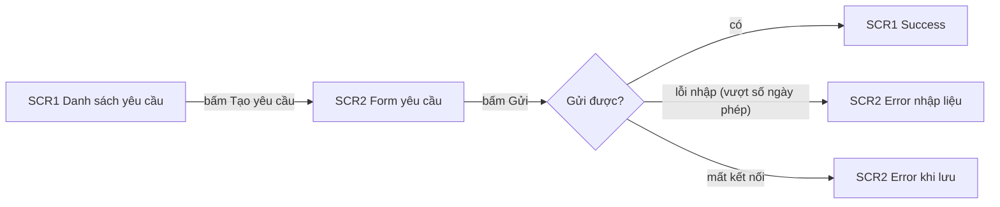

# Diagram Protocol

Luật vẽ sơ đồ trong artifact của UIUX: `flow-map.md`, mục Flow của `design-strategy.md`, file thiết kế UX đẩy lên repo PO ở D3. Cách phân tích flow nằm ở `engine/knowledge/flow-analysis.md`; tài liệu này chỉ quy định cách vẽ và cách kiểm. Quy tắc trùng với `engine/standards/diagrams.md` của PO-Workflow, nên file thiết kế UX đẩy sang repo PO qua được `po-tools.py check` bên đó.

## 1. Nguyên tắc

1. Sơ đồ viết bằng khối ` ```mermaid ` đặt ngay trong mục nó minh hoạ, không dùng ảnh. Mermaid là văn bản nên so được khác biệt theo dòng trong git và hiển thị được trên các nền tảng git phổ biến.
2. Bảng flow là nguồn, sơ đồ vẽ từ bảng. Sơ đồ không có màn hoặc nhánh nào mà bảng flow và danh sách màn không có. Sửa bảng thì sửa sơ đồ trong cùng lần sửa.
3. Mỗi sơ đồ có một câu mô tả bằng chữ ngay dưới khối, cho trường hợp sơ đồ không hiển thị được, theo AWS AI-DLC (`stage-protocol.md` mục 10, Mermaid diagram validation).
4. Mỗi sơ đồ tối đa 20 nút. Nhiều hơn thì tách theo FLOW, mỗi sơ đồ một flow hoặc một nhóm flow liền nhau.
5. UIUX không vẽ lại sơ đồ trạng thái của PRD. Màn hiển thị trạng thái của đối tượng đối chiếu với sơ đồ của PRD, theo `flow-analysis.md`.

## 2. Sơ đồ flow màn

- Dùng `flowchart LR`. Dòng đầu chỉ ghi loại sơ đồ và hướng.
- Mỗi nút là một màn, nhãn bắt đầu bằng mã `SCR<n>`, sau đó là tên màn. State của màn ghi sau mã, như `SCR2 Error`. Hộp xác nhận, modal, drawer có mã SCR riêng thì là nút riêng.
- Điểm rẽ dạng thoi `{"Câu hỏi?"}`. Nhãn mũi tên là thao tác của người dùng hoặc kết quả của hệ thống.
- Nhánh lỗi vẽ cùng sơ đồ với flow chính. Màn có sẵn nằm trong flow mà không đổi giao diện vẫn vẽ, nhãn ghi "không đổi".
- Flow có nhiều vai thì dùng `subgraph` cho mỗi vai.
- Mã nút viết không dấu, không khoảng trắng: `S1`, `SCR2E`. Tên tiếng Việt nằm ở nhãn.
- Tô màu bằng `style <mã> fill:#...,stroke:#...,color:#...`. Có `fill` thì phải có `color`, vì nơi hiển thị ở nền tối giữ màu chữ sáng trên nền ô sáng. Không dùng màu làm cách duy nhất để phân biệt; nhãn phải nói đủ.
- Không dùng khối `%%{init}%%` vì màu và giao diện do nơi hiển thị quyết định, không dùng `click` vì GitHub bỏ qua liên kết trong sơ đồ. Chỉ dùng năm dòng đầu khối như PO-Workflow: `flowchart`, `graph`, `stateDiagram-v2`, `sequenceDiagram`, `erDiagram`.



Sơ đồ trên: từ danh sách, người dùng mở form, gửi; gửi được thì về danh sách với thông báo thành công, lỗi nhập hoặc mất kết nối thì ở lại form với state lỗi tương ứng.

## 3. Lỗi cú pháp và cách kiểm

Sơ đồ sai cú pháp không hiển thị, người đọc chỉ thấy thông báo lỗi. Bảng dưới gồm các lỗi đã thử trên Mermaid 11.12. Danh sách ban đầu lấy từ `references/guides/troubleshooting.md` của repo `spillwavesolutions/design-doc-mermaid` (giấy phép MIT). Khoảng một nửa lỗi ở đó không còn xảy ra trên Mermaid 11, như mã nút bắt đầu bằng `o` hoặc `x`, dấu hai chấm hoặc dấu `#` trong nhãn nút, nên không đưa vào.

| Viết sai | Viết đúng |
|---|---|
| `S1[SCR1 Danh sách (rỗng)]`: nhãn có `( ) [ ] { } \| " @` mà không đặt trong ngoặc kép | `S1["SCR1 Danh sách (rỗng)"]` |
| `-->\|lỗi (vượt hạn mức)\|`: nhãn mũi tên có ký tự như trên | `-->\|"lỗi (vượt hạn mức)"\|` |
| `S1[/lop/chi-tiet]`: nhãn bắt đầu bằng `/` hoặc `\` bị đọc thành hình thang | `S1["/lop/chi-tiet"]` |
| `S3 --> end`: `end` viết thường là từ khoá đóng `subgraph` | `S3 --> KET_THUC` |
| `flowchart LR S1 --> S2`: nút viết cùng dòng đầu | Dòng đầu chỉ có `flowchart LR` |
| `subgraph` không có dòng `end` tương ứng | Mỗi `subgraph` một dòng `end` |
| `subgraph HV [Học viên (web)]`: tên subgraph có ký tự như trên | `subgraph HV ["Học viên (web)"]` |

Sơ đồ trạng thái, tuần tự, quan hệ thực thể có thêm lỗi riêng, liệt kê ở `engine/standards/diagrams.md` mục 6 của PO-Workflow. Script dưới kiểm cả các lỗi đó.

Cách kiểm, trước khi trình gate có sơ đồ và trước khi đẩy file thiết kế UX sang repo PO:

```
node engine/scripts/mermaid-lint.mjs intents/<slug>
```

Script chỉ cần Node.js bản 18 trở lên, không cần cài gói. Ngoài lỗi cú pháp, script báo `fill` thiếu `color` và sơ đồ quá 20 nút. Mã thoát 1 khi có lỗi. Máy không có Node thì AI rà từng sơ đồ theo bảng trên và ghi vào Limitation của stage rằng chưa kiểm bằng script. Script kiểm tĩnh nên không thay được việc xem sơ đồ hiển thị: Designer vẫn mở bản xem trước trên GitHub hoặc trình soạn thảo để thấy sơ đồ có đúng ý hay không.
